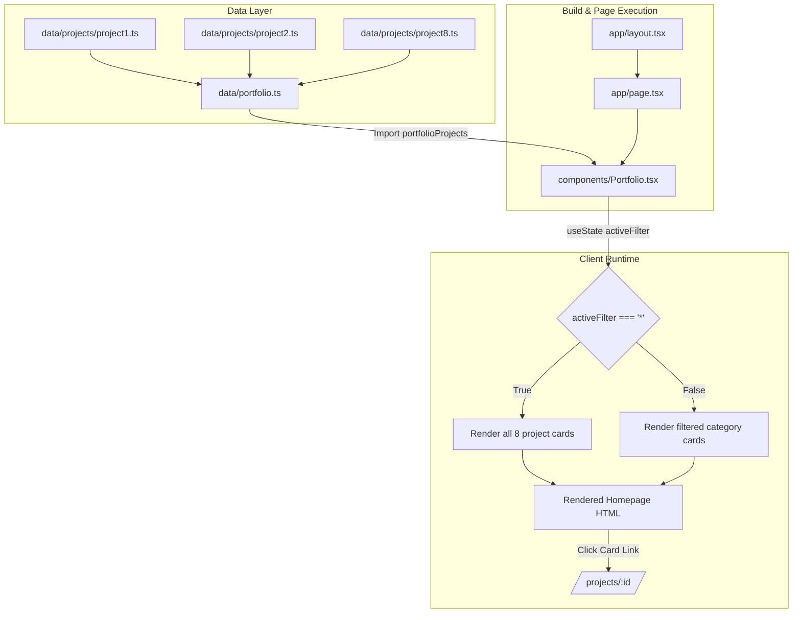
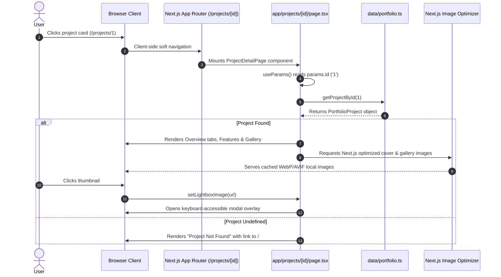
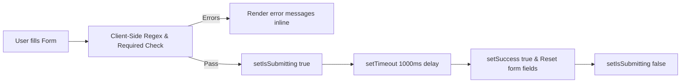

# Project Architecture & Workflow Specification: Portfolio

> **Document Purpose**: Comprehensive system architecture, data flow, and workflow analysis of the Next.js portfolio application. This document serves as the foundational reference for planning future dynamic portfolio integrations without modifying core design aesthetics or provisioning standalone application servers.

---

## 1. Project Overview

### 1.1 Purpose & Major Features
The project is a personal developer portfolio for **Moh. Asraful Hasan Asif** showcasing professional profile data, educational qualification, technical skills, client testimonials, and in-depth software project case studies. It was converted from a legacy HTML/CSS/jQuery template into a modern React/Next.js single-page application with dedicated project detail routes.

**Core User Features:**
* **Hero Presentation:** Animated typewriter effect cycling through professional titles, personal avatar, dynamic resume download (`/public/my_cv.pdf`), and video introduction trigger.
* **About & Biography:** Personal contact information cards, profile imagery, social media links, and biographical statistics.
* **Skills Assessment:** Tabbed skill categorization (All, Frontend, Backend, Databases, DevOps, Tools) with animated percentage progress bars triggered upon scroll intersection.
* **Education & Experience Timeline:** Dual-column chronological trajectory of academic background and professional experience.
* **Portfolio Showcase:** Category-based filter tabs ("All", "Frontend", "Backend") displaying project cards with hover overlays, glowing borders, and route links.
* **Interactive Project Detail Pages (`/projects/[id]`):** Dedicated deep-dive case studies displaying cover photography, project timeline/role/stack badges, tabbed narratives (Overview, Solution, Challenges), responsive image galleries with interactive keyboard-navigable lightboxes, structured key features lists, GitHub/Live Demo links, and related project suggestions.
* **Client Testimonials:** Responsive carousel powered by Swiper with pagination bullets and auto-play transitions.
* **Contact Form:** Interactive inquiry form with client-side field validation and simulated asynchronous submission handling.
* **Responsive Fixed Navigation:** Header navbar that applies background blur and border changes upon scrolling past 200px, accompanied by section tracking and smooth scroll anchor navigation.

### 1.2 Technology Stack
* **Framework:** Next.js `14.2.33` (App Router architecture)
* **Runtime / Core Library:** React `18.3.0` & React DOM `18.3.0`
* **Programming Language:** TypeScript `5.4.0` (Target: `ES2020`, Module Resolution: `bundler`, Strict mode enabled)
* **Styling Engine:** Tailwind CSS `3.4.0` with `@tailwindcss` PostCSS plugin (`postcss 8.4.0`, `autoprefixer 10.4.0`)
* **Motion & Animations:** `framer-motion 11.0.0` for staggered viewport animations and micro-interactions
* **Intersection Observers:** `react-intersection-observer 9.5.0` for scroll-triggered animation controls and skill bar progress rendering
* **Carousels & Sliders:** `swiper 11.0.0`
* **Icons:** `react-icons 5.5.0` (FontAwesome `Fa*` and Heroicons `Hi*`)
* **Typography:** Next.js Font Optimization (`next/font/google`) importing `Inter` with CSS variable `--font-sans`

### 1.3 Routing Architecture
The project exclusively uses Next.js **App Router** rooted in the `/app` directory:
* `/app/layout.tsx` — Global root layout with metadata, Google font injection, and dark color scheme default.
* `/app/page.tsx` — Single-page homepage composing modular section components.
* `/app/projects/[id]/page.tsx` — Dynamic client-rendered detail view parameterized by project numeric ID.
* *Pages Router (`/pages`):* Not utilized. Although `tailwind.config.ts` includes `./pages/**/*.{...}` in its content array for legacy reasons, no `/pages` directory exists in the codebase.

### 1.4 Package Manager & Tooling Scripts
* **Package Manager:** `npm` (tracked via `package-lock.json` lockfile version 3).
* **Available Scripts (`package.json`):**
  * `npm run dev`: Starts Next.js development server at `http://localhost:3000` via `next dev`.
  * `npm run build`: Compiles production assets via `next build`.
  * `npm run start`: Boots production Node server via `next start`.
  * `npm run lint`: Executes `next lint`. *(Note: Fails under current dependencies; see Section 10).*
  * *Test Scripts:* None configured (`npm test` does not exist in `package.json`).

### 1.5 Hosting & Deployment Configuration
* **Target Host:** Vercel (indicated by `.vercel` entry in `.gitignore`, existing public deployment URLs such as `cry-zen.vercel.app`, and standard zero-config Next.js Vercel conventions).
* **Git Remote:** Origin points to `https://github.com/Asif259/Portfolio.git` (active branch: `main`).
* **CI/CD Workflows:** No `.github/workflows` directory is present in the repository; automated deployments are driven by Vercel's Git webhook integration on commit pushes to `main`.

### 1.6 External Integrations, APIs, and Data Stores
* **Databases:** None connected.
* **Headless CMS / Content APIs:** None.
* **Authentication Services:** None in the portfolio itself (mock form interactions; project case studies document external auth systems used in third-party client apps).
* **Storage Buckets / CDNs:** None. All assets are served statically from the local filesystem `/public`.
* **External APIs:** No outbound `fetch` or HTTP requests are executed at build time or runtime.

---

## 2. Project Structure

```
Portfolio/
├── .agent/                    # Agent workflows, rules, and scripts
├── .eslintrc.json             # ESLint configuration
├── .gitignore                 # Git ignore rules (includes .vercel, node_modules, .next)
├── app/                       # Next.js App Router Root
│   ├── globals.css            # Tailwind directives, custom utilities, neon glows, scrollbars
│   ├── layout.tsx             # Root HTML shell, fonts, SEO metadata
│   ├── page.tsx               # Main portfolio landing page
│   └── projects/              # Dynamic project route segment
│       └── [id]/              # Dynamic route parameter segment
│           └── page.tsx       # Dynamic project detail page (Client Component)
├── components/                # Reusable UI & Section Components
│   ├── About.tsx              # Bio, contact attributes, personal details
│   ├── Contact.tsx            # Contact form with validation & mock dispatch
│   ├── FadeIn.tsx             # Framer Motion fade & stagger viewport wrappers
│   ├── Footer.tsx             # Footer links & copyright
│   ├── Hero.tsx               # Hero header, typewriter effect, CV download
│   ├── Navbar.tsx             # Sticky responsive navigation with scroll spy
│   ├── Portfolio.tsx          # Project showcase grid & category filter tabs
│   ├── Qualification.tsx      # Chronological education & experience cards
│   ├── Skills.tsx             # Category-filtered skill progress bars
│   └── Testimonials.tsx       # Swiper carousel displaying client reviews
├── data/                      # Structured Data Stores
│   ├── portfolio.ts           # Type definitions & aggregator for all portfolio projects
│   └── projects/              # Individual project definition modules (project1.ts – project8.ts)
│       ├── project1.ts        # Cryzen Website
│       ├── project2.ts        # Culinary Odyssey
│       ├── project3.ts        # Home Decor And More
│       ├── project4.ts        # Doctein Platform
│       ├── project5.ts        # Elegant Tech
│       ├── project6.ts        # Careem Website
│       ├── project7.ts        # Nexus Event Management
│       └── project8.ts        # BariVara Platform
├── public/                    # Static Assets Directory
│   ├── img/                   # Image assets grouped by project subfolder
│   │   ├── barivara/          # BariVara project PNG screenshots
│   │   ├── careem/            # Careem project screenshots
│   │   ├── cryzen/            # Cryzen project screenshots
│   │   ├── culinary-odissey/  # Culinary Odyssey screenshots
│   │   ├── doctein/           # Doctein screenshots
│   │   ├── elegant-tech/      # Elegant Tech screenshots
│   │   ├── home-decor-and-more/ # E-commerce screenshots
│   │   ├── nexus/             # Nexus event screenshots
│   │   ├── asif.jpg           # Profile & favicon images
│   │   └── testimonial-*.jpg  # Reviewer profile photos
│   ├── my_cv.pdf              # Downloadable curriculum vitae
│   ├── video-portfolio.mp4    # Local video asset
│   └── video-thumbnail.png    # Video preview placeholder
├── next.config.js             # Next.js bundler and image configuration
├── package.json               # Dependencies and execution scripts
├── postcss.config.js          # PostCSS configuration for Tailwind CSS
├── tailwind.config.ts         # Tailwind design system tokens, color palettes, animations
└── tsconfig.json              # TypeScript compilation settings & path aliases (@/* -> ./*)
```

### Explanations of Crucial Directories and Files

| File / Directory | Classification | Architectural Role |
|---|---|---|
| `app/layout.tsx` | App Router Layout | Renders `<html>` and `<body>`, links favicon `/img/asif.jpg`, configures Inter font variable, sets global title and meta description. |
| `app/page.tsx` | Page Entry Point | Orchestrates the top-level section components into a vertically scrolling single-page layout. |
| `app/projects/[id]/page.tsx` | Dynamic Route Page | Client component consuming `useParams()`, looking up project record by integer ID, and rendering the rich case study view. |
| `components/Portfolio.tsx` | UI Section Component | Client component reading `portfolioProjects` from `@/data/portfolio`, providing category state filtering and rendering clickable project cards. |
| `components/FadeIn.tsx` | Animation Utility | Exposes `<FadeIn>`, `<StaggerContainer>`, and `<StaggerItem>` wrappers powered by `framer-motion` and `react-intersection-observer`. |
| `data/portfolio.ts` | Data Master & Types | Declares `PortfolioProject`, `FeatureItem`, `FeatureSection`, and `Challenge` TypeScript interfaces; aggregates `project1` through `project8`; exports `portfolioProjects` array and `getProjectById()` helper. |
| `data/projects/` | Data Content Modules | Independent TypeScript modules exporting strongly typed project data objects. |
| `next.config.js` | Build Configuration | Sets `images: { unoptimized: false }` and provides a Webpack fallback for Swiper CSS (`fs: false` on client builds). |
| `tailwind.config.ts` | Design Token System | Configures custom theme colors (Teal/Emerald `#14b8a6` primary, Orange `#FF6A00` accent, Dark `#121212` backgrounds), glow shadows, and keyframes. |

---

## 3. Existing Portfolio Section: Detailed Analysis

### 3.1 Data Source and Storage Pattern
Project information is **statically hardcoded in TypeScript files** within the repository codebase:
1. Individual project files reside in `/data/projects/project[1-8].ts`.
2. Each file instantiates and exports a typed constant (e.g., `export const project1: PortfolioProject = { ... }`).
3. `/data/portfolio.ts` imports all eight project modules individually and constructs the primary export:
   ```ts
   export const portfolioProjects: PortfolioProject[] = [
     project1, project2, project3, project4,
     project5, project6, project7, project8,
   ];
   ```
4. Querying a specific project occurs via the synchronous helper in `/data/portfolio.ts`:
   ```ts
   export function getProjectById(id: number): PortfolioProject | undefined {
     return portfolioProjects.find((project) => project.id === id);
   }
   ```

### 3.2 Data Structure: Types & Interfaces
Defined in `/data/portfolio.ts`:

```ts
export interface FeatureItem {
  name: string;
  description: string;
}

export interface FeatureSection {
  title: string;
  items: FeatureItem[];
}

export interface Challenge {
  title: string;
  description: string;
}

export interface PortfolioProject {
  id: number;
  name: string;
  category:
    | "Frontend Development"
    | "Backend Development"
    | "Full Stack Development";
  coverImage: string;
  images: string[];
  description: string;
  longDescription: string;
  technologies: string[];
  features: string[] | FeatureSection[];
  challenges: string[] | Challenge[];
  solution: string;
  liveUrl?: string;
  githubUrl?: string[];
  date: string;
  client?: string;
  role: string;
}
```

#### Field Schema Breakdown:
* `id` (`number`): Primary numeric identifier (e.g., `1`, `2`, ..., `8`). Used directly in URL parameterization `/projects/${item.id}`.
* `name` (`string`): Project headline title.
* `category` (`string union`): Constrained to `"Frontend Development" | "Backend Development" | "Full Stack Development"`.
* `coverImage` (`string`): Relative URL pointing to root-relative static asset path (e.g., `"/img/cryzen/cryzen-1.png"`).
* `images` (`string[]`): Array of relative URLs for screenshots rendered in the detail page gallery and lightbox.
* `description` (`string`): Short summary (1-2 sentences) displayed on the homepage card and hero header.
* `longDescription` (`string`): Comprehensive multi-paragraph text rendered inside the "Overview" tab on the detail page.
* `technologies` (`string[]`): List of technology stack keywords (e.g., `["Next.js", "NestJS", "PostgreSQL"]`).
* `features` (`string[] | FeatureSection[]`): **Polymorphic type**. Can be either:
  1. A simple flat array of strings (`string[]`), rendered as checkmark list items.
  2. A grouped array of sections (`FeatureSection[]`), rendered as titled subheadings with card grids containing `name` and `description`.
* `challenges` (`string[] | Challenge[]`): **Polymorphic type**. Can be either:
  1. A simple array of strings (`string[]`).
  2. An array of objects (`Challenge[]`), rendered with highlighted title headers and descriptive paragraphs.
* `solution` (`string`): Detailed architectural narrative explaining how the challenges were solved.
* `liveUrl` (`string`, optional): External production deployment URL.
* `githubUrl` (`string[]`, optional): Array of repository links (e.g., separate frontend and backend repo links).
* `date` (`string`): ISO date string (`"YYYY-MM-DD"`). Formatted at runtime via `new Date(project.date).toLocaleDateString()`.
* `client` (`string`, optional): Client or organization name.
* `role` (`string`): Author's professional capacity (e.g., `"Frontend Developer"`, `"Full Stack Developer"`).

### 3.3 Image Handling & Resolution
* **Asset Location:** Images are stored physically in `/public/img/<project-slug>/`.
* **Component Used:** Next.js `<Image />` component (`next/image`).
* **Path Referencing:** Referenced as public root URLs (`/img/...`). Next.js serves files from `/public` directly at the web root `/`.
* **Optimization:** `next.config.js` sets `unoptimized: false`, enabling Next.js on-demand WebP/AVIF resizing and compression.
* **Remote Configuration:** Currently, `next.config.js` contains **no** `remotePatterns` or `domains`. Any image path not starting with a local leading slash will trigger a runtime error during Next.js image optimization.

### 3.4 Homepage Gallery Rendering & Filtering (`components/Portfolio.tsx`)
* The component declares `"use client"`.
* **Filter State:** `const [activeFilter, setActiveFilter] = useState<string>("*")`.
* **Filter Options Rendered:**
  ```tsx
  {["*", "Frontend Development", "Backend Development"].map((filter) => ...)}
  ```
* **Filter Matching Logic:**
  ```tsx
  const filteredItems =
    activeFilter === "*"
      ? portfolioProjects
      : portfolioProjects.filter((item) => item.category === activeFilter);
  ```
  *(Important Architectural Note: Projects categorized as `"Full Stack Development"` do not have an explicit filter button; they appear only when `activeFilter === "*"`).*
* **Card Interaction:** Each card is wrapped in Next.js `<Link href={`/projects/${item.id}`}>`. Clicking anywhere on the card navigates client-side to the dynamic project route.

### 3.5 Detail Page Implementation (`app/projects/[id]/page.tsx`)
* Declares `"use client"`.
* Parses URL parameter via `useParams()`: `const id = parseInt(params.id as string)`.
* Retrieves project data synchronously: `const project = getProjectById(id)`.
* **Interactive Features:**
  * **Hero Summary:** Cover image, timeline badge, role badge, primary technology badge, and direct links to Live Demo and GitHub.
  * **Tabbed Content (`overview` | `solution` | `challenges`):** Dynamic tab switching maintaining state in `activeTab`. Handles polymorphic `challenges` rendering (either strings or `{ title, description }` objects).
  * **Feature Grid:** Intelligently checks `typeof project.features[0] === "object"` to dynamically switch between rendering categorized feature cards (`FeatureSection[]`) or simple bullet tags (`string[]`).
  * **Interactive Gallery Lightbox:** Clicking any gallery thumbnail opens a modal (`lightboxImage`). Adds global keyboard listeners for `Escape` (close), `ArrowLeft` (previous image), and `ArrowRight` (next image) with wrap-around index calculation.
  * **Related Projects:** Filters `portfolioProjects` by matching `category` (excluding the current project ID) and renders up to 3 recommendation cards.

---

## 4. Application Data Flow

### 4.1 Homepage Data & Render Flow


### 4.2 Dynamic Project Detail Flow


### 4.3 Form Submission Flow (`components/Contact.tsx`)

*(No backend network call or API route is executed; submission is strictly client-side simulation).*

---

## 5. Existing Data Management and Content Update Workflow

To add, modify, or delete a portfolio project in the current architecture, a developer must complete the following mandatory steps:

### 5.1 Step-by-Step Content Addition Procedure
1. **Asset Staging:**
   * Create a new folder inside `public/img/<project-slug>/`.
   * Add image files (e.g., `cover.png`, `screen-1.png`, `screen-2.png`).
2. **Project Definition File Creation:**
   * Create a new TypeScript file: `data/projects/project<N>.ts`.
   * Import `PortfolioProject` from `../portfolio`.
   * Manually construct the full `PortfolioProject` object, ensuring correct typing and formatting for `id`, `name`, `category`, `coverImage`, `images`, `description`, `longDescription`, `technologies`, `features`, `challenges`, `solution`, `liveUrl`, `githubUrl`, `date`, `client`, and `role`.
3. **Registry Update:**
   * Open `data/portfolio.ts`.
   * Add import: `import { project<N> } from "./projects/project<N>";`.
   * Append `project<N>` to the `portfolioProjects` array export.
4. **Build & Quality Check:**
   * Run `npm run build` locally to verify TypeScript compilation and static page generation without type mismatches or syntax errors.
5. **Git Commit & Deployment:**
   * Stage files: `git add public/img/<project-slug> data/projects/project<N>.ts data/portfolio.ts`.
   * Commit: `git commit -m "feat: add project <N> details"`.
   * Push to remote: `git push origin main`.
   * Wait for Vercel build and redeployment to complete before changes become live.

### 5.2 Required Edits Matrix

| Task | Files Requiring Direct Modification | Asset Updates Required | Deployment Required? |
|---|---|---|---|
| **Add New Project** | `data/projects/project<N>.ts`<br>`data/portfolio.ts` | Copy image files to `public/img/<folder>/` | **Yes (Full Redeploy)** |
| **Edit Project Copy/Link** | `data/projects/project<N>.ts` | None | **Yes (Full Redeploy)** |
| **Swap Project Images** | `data/projects/project<N>.ts` | Overwrite or add files in `public/img/` | **Yes (Full Redeploy)** |
| **Delete Project** | `data/portfolio.ts`<br>*(Optional delete `data/projects/project<N>.ts`)* | *(Optional delete files in `public/img/`)* | **Yes (Full Redeploy)** |

### 5.3 Limitations of Current Workflow
* **Code Modification for Content:** Every spelling fix, URL change, or new project requires code-level edits in TypeScript files. Non-developers cannot manage content.
* **Tight Coupling to Deployment Pipeline:** Content updates cannot happen out-of-band; every edit triggers a full Vercel build and bundle compilation.
* **Large Repository Size:** High-resolution screenshots are checked directly into Git history (`public/img/nexus/nexus-1.png` alone is ~8 MB; `public/img/` totals over 35 MB), causing repository bloat over time.
* **Human Error Surface:** Image paths are raw strings without compile-time path verification. Typos directly result in broken images in production (as occurred in `project8.ts`).

---

## 6. Technical Constraints and Dependencies

### 6.1 Framework & Runtime Constraints
* **Next.js Version:** `14.2.33` running under Node.js 18+ runtime.
* **Dynamic Route Rendering:** `/projects/[id]` is currently rendered as a dynamic route (`ƒ (Dynamic)`) on demand because it does not implement `generateStaticParams()`.
* **Static Export (`output: 'export'`):** The application currently does **not** use static export (`next.config.js` does not set `output: 'export'`). If static export were enabled in the future, `/projects/[id]` would fail to build unless `generateStaticParams` is implemented to supply all valid IDs ahead of time.

### 6.2 Image Optimization Constraints
* `next.config.js` sets `images: { unoptimized: false }`.
* Next.js requires remote domains or pattern matching in `images.remotePatterns` for any external image host (e.g., Cloudinary, Supabase Storage, Sanity CDN, GitHub User Content).
* Without updating `next.config.js`, any attempt to load images from remote URLs will trigger:
  `Error: Invalid src prop on next/image, hostname "..." is not configured under images in your next.config.js`.

### 6.3 Environment Variables
* The codebase currently uses **zero environment variables** (no `.env`, `.env.local`, or `process.env.*` references exist).
* Any future API, database, or CMS integration requiring tokens or endpoint URLs will necessitate establishing a secure `.env.local` pattern with clear separation between public variables (`NEXT_PUBLIC_*`) and private server keys.

### 6.4 Dependency Conflicts & Technical Debt
* **ESLint 9 Incompatibility:** Running `npm run lint` yields a fatal configuration error. `package.json` installs `eslint: "^9.38.0"` and `eslint-config-next: "^16.0.1"`, whereas Next.js `14.2.x` expects ESLint 8 and legacy `.eslintrc` options.
* **Swiper Webpack Fallback:** `next.config.js` includes a custom Webpack fallback (`resolve.fallback.fs = false`) specifically to prevent client-side build errors when bundling Swiper modules.

---

## 7. Future Enhancement: Dynamic Portfolio Requirements

The future objective is to allow managing project data and images without touching frontend source code and without maintaining a custom backend server or SQL database.

Below is an objective evaluation of possible architectural approaches:

### Evaluation of Candidate Architectural Approaches

```
+-------------------------------------------------------------------------------------------------------------------------+
| Approach               | Compatibility | Data & Image Storage     | Content Update Workflow     | Redeploy? | Trade-offs |
+-------------------------------------------------------------------------------------------------------------------------+
| 1. Local JSON / TS     | 100% Native   | Local repository files   | Manual Git edit & commit    | Yes       | Simple, but requires code repo access |
| 2. GitHub API + Config | High          | GitHub Repo / Releases   | Commit JSON to repo/branch  | Optional* | Rate limits (60/hr unauth), latency   |
| 3. Git-based CMS (Decap| High          | Markdown/JSON in Git     | Web CMS UI commits to Git   | Yes       | Zero DB cost, but triggers Vercel build|
| 4. Headless CMS (Sanity| High          | Cloud CDN & Managed DB   | Web Studio UI               | No* (ISR) | Free-tier limits, needs remotePatterns|
| 5. BaaS (Supabase/Neon)| High          | Managed DB + S3 Bucket   | Custom UI or Table Editor   | No* (ISR) | Requires client SDK or Server Actions |
+-------------------------------------------------------------------------------------------------------------------------+
*With Next.js App Router Incremental Static Regeneration (ISR) or dynamic server fetch with cache tags.
```

#### Approach 1: Consolidated Local Data File (JSON / TS)
* **How it works:** Consolidates all projects into a single validated JSON or TypeScript structure, or introduces a local schema validator (e.g., Zod).
* **Pros:** Zero third-party dependencies, zero latency, zero hosting cost.
* **Cons:** Does not meet the primary objective of eliminating code edits and manual git pushes for content management.

#### Approach 2: GitHub Repository Content via GitHub API
* **How it works:** Project definitions are stored in a dedicated public/private GitHub repository as a `projects.json` file or Markdown files. The Next.js app fetches them at build time or on demand using the GitHub REST API (`https://api.github.com/repos/.../contents/...`). Images are hosted in repo release assets or raw file URLs.
* **Pros:** No separate database or server to maintain; GitHub handles storage and version history.
* **Cons:** Unauthenticated GitHub API calls are restricted to 60 requests/hour per IP. Needs a personal access token (`GITHUB_TOKEN`) for private repos or higher rate limits. Still requires committing files via Git or GitHub web interface.

#### Approach 3: Git-Based Headless CMS (Decap CMS / Front Matter / TinaCMS)
* **How it works:** A CMS admin interface running on `/admin` that authenticates via GitHub OAuth. Editors use a visual dashboard to create projects and upload images; the CMS commits changes directly to the Git repository via the GitHub API.
* **Pros:** Visual content editor; images uploaded directly to repo; no database server.
* **Cons:** Every content update triggers a full Vercel build and redeployment. Media files remain inside the Git repository.

#### Approach 4: Hosted Headless CMS (Sanity.io / Hygraph / Contentful) — *Recommended for Serverless Dynamic Content*
* **How it works:** Content lives in a managed cloud CMS. Project metadata and images are uploaded via an official web dashboard. Next.js fetches data using `fetch('https://cdn.sanity.io/...', { next: { revalidate: 60 } })`. Images are hosted and resized by the CMS CDN.
* **Pros:** Completely eliminates code changes and manual deployments. Instant visual editing. Professional image CDN with automatic WebP conversion and focal cropping. Generous free tiers.
* **Requirements:**
  1. Add CMS project ID and API token to environment variables.
  2. Add CMS image CDN domain (e.g., `cdn.sanity.io`) to `images.remotePatterns` in `next.config.js`.
  3. Convert `/app/projects/[id]/page.tsx` from synchronous array lookup to asynchronous data fetching (or Server Component).

#### Approach 5: Backend-as-a-Service (Supabase / Neon + S3)
* **How it works:** Projects stored in PostgreSQL table (or Neon serverless Postgres); images stored in S3/Supabase Storage bucket. Next.js fetches via SQL or REST.
* **Pros:** Full relational data integrity; fine-grained access control.
* **Cons:** Managing schema migrations and image upload pipelines requires more overhead than a dedicated content CMS.

---

## 8. Existing Design and Behavior That Must Be Preserved

When refactoring the data source for the portfolio section, the following UI/UX specifications and design conventions must remain intact:

### 8.1 Visual Theme & Color Palette
* **Base Background:** `#121212` (global canvas background).
* **Card Background:** `#1E1E1E` with subtle border `1px solid rgba(20, 184, 166, 0.12)` and box shadow `0 4px 24px rgba(0,0,0,0.4)`.
* **Primary Brand Colors:**
  * Teal `#14b8a6` (`primary-500`)
  * Light Teal `#2dd4bf` (`primary-400`)
  * Deep Teal `#0d9488` (`primary-600`)
  * Accent Glow: `rgba(20, 184, 166, 0.35)`
* **Typography:** Inter (`sans-serif`), High-contrast slate titles (`#f1f5f9`), muted body text (`#94a3b8`).
* **Header Watermark:** Double-layered section headers with large faint background text (`.section-header-bg` in outline teal) overlaid with prominent teal title (`.section-header-text`).

### 8.2 Component Hierarchy & Layout Conventions
* **Grid Layout (`components/Portfolio.tsx`):**
  * Mobile (< 768px): 1 column (`grid-cols-1`)
  * Tablet (768px – 1024px): 2 columns (`md:grid-cols-2`)
  * Desktop (>= 1024px): 3 columns (`lg:grid-cols-3`)
  * Gap: `gap-6` (24px)
* **Hover Interaction:** Card scales slightly on hover (`scale-105`), dark gradient overlay fades in (`.portfolio-overlay`), and border glow intensifies (`rgba(20, 184, 166, 0.4)`).
* **Category Pill:** Category badge displayed inside overlay and detail page:
  `background: rgba(20, 184, 166, 0.15)`, `border: rgba(20, 184, 166, 0.4)`, `color: #2dd4bf`.

### 8.3 Project Detail Page Architecture (`app/projects/[id]/page.tsx`)
* **Two-Column Hero Split:** Sticky cover image preview on the left; title, breadcrumbs, category badge, date/role/stack quick cards, and action buttons on the right.
* **Tab Navigation:** Three tabs (`Overview`, `Solution`, `Challenges`) with active state highlighted in teal gradient.
* **Polymorphic Feature Display:** Supports both simple feature bullet points and structured feature sections with checkmark icons.
* **Full-Screen Interactive Lightbox:**
  * Dark backdrop (`rgba(18, 18, 18, 0.95)`).
  * High-resolution image preview.
  * Previous / Next / Close buttons.
  * Keyboard bindings for `Escape`, `ArrowLeft`, and `ArrowRight`.
* **Related Projects Footer:** 3-column grid suggesting related projects matching the current project category.
* **"View All Projects" CTA:** Return link targeting `/#portfolio` on the homepage.

---

## 9. Important Files Reference

| File Path | Purpose | Relevant Functionality | Importance for Dynamic Portfolio |
|---|---|---|---|
| `data/portfolio.ts` | Type definitions and project aggregator | Exports `PortfolioProject`, `FeatureSection`, `Challenge` interfaces; exports `portfolioProjects` array and `getProjectById(id)` lookup helper. | **Critical:** Currently the single source of truth for portfolio types and lookup logic. Will be replaced or adapted into an asynchronous data fetching service. |
| `data/projects/project[1-8].ts` | Static project data records | Exports strongly typed individual project constants containing all copy, image paths, feature trees, and metadata. | **High:** Reference schemas and baseline datasets when migrating data to an external CMS or dynamic repository. |
| `components/Portfolio.tsx` | Gallery showcase UI | Consumes `portfolioProjects`; implements category filter buttons; renders responsive grid and card hover states. | **Critical:** Must be adapted to consume projects dynamically (via props or client hook) without altering card styles or animations. |
| `app/projects/[id]/page.tsx` | Project detail case study page | Reads route param `params.id`; looks up project via `getProjectById`; renders tabs, gallery lightbox, feature cards, and related projects. | **Critical:** Primary target for refactoring from synchronous local lookup to dynamic route data resolution (or Server Component with ISR). |
| `next.config.js` | Next.js build and image configuration | Defines image optimization options and Webpack client fallback for Swiper. | **Critical:** Must be updated with `images.remotePatterns` as soon as any external image host or CDN is introduced. |
| `app/globals.css` | Global styling & design utilities | Custom utility classes: `.section-header`, `.section-header-bg`, `.portfolio-overlay`, `.portfolio-item`, `.card`, `.neon-border`. | **Medium:** Defines the exact aesthetic tokens, glowing borders, and animations that must be preserved. |
| `tailwind.config.ts` | Tailwind CSS configuration | Defines theme color tokens (primary teal `#14b8a6`, orange `#FF6A00`), grid patterns, and glow box shadows. | **Medium:** Contains styling tokens referenced by portfolio cards and detail page components. |
| `components/FadeIn.tsx` | Motion wrapper | Exports `<FadeIn>`, `<StaggerContainer>`, and `<StaggerItem>` wrappers powered by Framer Motion. | **Low / Medium:** Used by `Portfolio.tsx` for stagger entrance animations; must be maintained to preserve visual fluidity. |
| `package.json` | Dependencies & scripts | Lists framework packages, runtime dependencies, build commands, and package scripts. | **Medium:** Needed when auditing dependencies or resolving ESLint/Next.js script incompatibilities. |

---

## 10. Risks, Unknowns, and Implementation Considerations

### 10.1 Identified Bugs & Existing Technical Debt
1. **Broken Image Paths in `project8.ts`:**
   * In `data/projects/project8.ts`, images are referenced as:
     `coverImage: "/images/bariara/barivara1.png"`
     `images: ["/images/bariara/barivara1.png", ...]`
   * However, the actual files in `/public` are located at:
     `/public/img/barivara/barivara1.png` through `barivara10.png`.
   * **Result:** All images for project 8 fail to load in the current application.
2. **Missing "Full Stack Development" Filter Button in `Portfolio.tsx`:**
   * `components/Portfolio.tsx` lines 57–58 only render filter buttons for:
     `["*", "Frontend Development", "Backend Development"]`
   * Four projects (`project2`, `project3`, `project4`, `project7`, `project8`) have `category: "Full Stack Development"`.
   * **Result:** Users cannot explicitly filter for Full Stack projects; they only appear when the "*" ("All") filter is active.
3. **`npm run lint` Dependency Mismatch:**
   * ESLint 9 (`eslint: "^9.38.0"`) installed alongside Next.js 14 (`^14.2.0`) breaks `next lint` due to removed command-line flags. Needs alignment if CI linting is activated.

### 10.2 Architectural Considerations for Dynamic Migration
1. **Client vs. Server Component Boundary:**
   * Both `components/Portfolio.tsx` and `app/projects/[id]/page.tsx` currently declare `"use client"`.
   * `app/projects/[id]/page.tsx` uses `useParams()` from `next/navigation` to read the ID in client state.
   * *Best Practice for Dynamic Data:* If migrating to a CMS or dynamic data source, consider refactoring `app/projects/[id]/page.tsx` into an async **Server Component** (`async function ProjectDetailPage({ params }: { params: { id: string } })`). This enables direct server-side data fetching, SEO meta tag generation via `generateMetadata()`, and static generation via `generateStaticParams()`, while isolating interactive features (tabs, lightbox modal) into focused client subcomponents.
2. **Remote Image Domain Configuration:**
   * Any remote image URL from a CMS (e.g., Sanity CDN, Supabase Storage, Cloudinary, Imgur) will trigger a fatal Next.js Image error unless explicitly whitelisted in `next.config.js` under `images.remotePatterns`.
3. **ID Representation (Numeric vs. Slug):**
   * Currently, all projects use sequential integers (`id: 1` through `8`).
   * Dynamic content platforms typically use unique alphanumeric slugs (e.g., `cryzen-platform`, `barivara-app`).
   * *Decision Point:* Decide whether future routes should remain `/projects/[id]` (numeric ID) or transition to human-readable `/projects/[slug]` with backward-compatible redirects.
4. **Data Validation Strategy:**
   * Because `features` and `challenges` currently accept polymorphic types (`string[]` vs. `FeatureSection[]` / `Challenge[]`), any CMS or API integration must enforce a strict schema (e.g., using Zod) to guarantee runtime stability and avoid rendering exceptions.

---

## 11. Summary & Next Steps for Future Implementation

This documentation establishes that the existing portfolio codebase is a clean, well-structured Next.js 14 App Router application with zero backend infrastructure. The UI design system relies on a consistent dark teal aesthetic, Framer Motion animations, and custom Tailwind components.

When designing the dynamic portfolio enhancement:
1. **Preserve the UI contracts:** Keep the visual structure of `components/Portfolio.tsx` and `app/projects/[id]/page.tsx`.
2. **Resolve the data provider:** Replace the static imports in `data/portfolio.ts` with an asynchronous service layer connected to the chosen content source.
3. **Configure remote images:** Update `next.config.js` with remote image pattern matching.
4. **Correct legacy data inconsistencies:** Fix the image path typo in `project8.ts` and add the missing "Full Stack Development" filter category.
